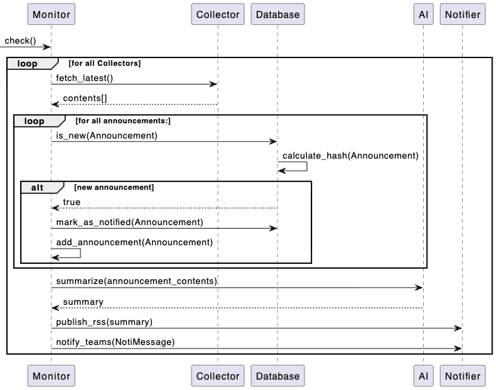
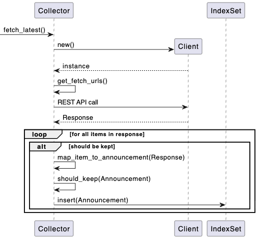

# Noticrawl

공공기관 지원사업, 입찰 공고를 자동으로 수집하고 AI로 요약해 배포하는 공고 요약 서비스

## 프로젝트 개요

스타트업 혹은 중소기업이 참여할 만한 정부 지원사업과 입찰 공고는 K-Startup, 기업마당, e나라도움, 나라장터, SMTech 등 여러 포털에 흩어져 있어 매일 일일이 확인하기 어렵다.
Noticrawl은 이 포털들의 공개 API를 주기적으로 조회해 새로 올라온 공고만 골라내고, LLM 서비스(현제는 Gemini)로 요약한 뒤 RSS 피드로 게시하고 MS Teams로 알림을 보내주어 사용자에게 관련 정부 공지 사항을 종합적으로 추적할 수 있도록 한다.

처리 흐름:

```
수집(Collectors) -> 키워드 필터링 -> 신규 공고 여부 확인(SQLite) -> AI 요약(Gemini)
  -> RSS로 게시(GitHub Pages) -> 요약 알림(MS Teams, Power Automate)
```

기술 스택: Rust (edition 2024), tokio, reqwest, sqlx/SQLite, tokio-cron-scheduler, quick-xml/rss, Google Gemini API

## 주요 기능

- **다중 소스 수집**: 다섯 개 공공 포털의 공고 수집 (JSON / XML / RSS 응답 처리)

  | 소스 | 모듈 | API 키 환경 변수 |
  |---|---|---|
  | K-Startup | `collectors/kstartup.rs` | `KSTARTUP_KEY` |
  | 기업마당 (BizInfo) | `collectors/bizinfo.rs` | `BIZINFO_KEY` |
  | e나라도움 | `collectors/enara.rs` | `ENARA_KEY` |
  | 나라장터 | `collectors/naramarket.rs` | `NARAMARKET_KEY` |
  | SMTech | `collectors/smtech.rs` | `SMTECH_KEY` |

- **키워드 필터링**: 소스별 `search_terms`가 제목 또는 본문에 포함된 공고만 남김 (`collectors/filter_policy.rs`)
- **중복 방지**: 공고 해시(blake3)를 SQLite에 저장해 이미 처리한 공고는 건너뜀 (`db.rs`, `sql/`)
- **AI 요약**: 신규 공고를 Gemini(`gemini-2.5-flash-lite`)로 요약 (`summarizer/`)
- **RSS 게시**: GitHub Contents API로 RSS 파일을 피드 저장소에 커밋해 GitHub Pages로 게시 (`noti/ghclient.rs`)
- **Teams 알림**: 게시된 RSS를 다시 짧게 요약해 Power Automate 웹훅으로 MS Teams에 전송 (`noti/notifier.rs`)
- **스케줄 실행**: `config.toml`의 cron 표현식과 시간대에 맞춰 주기적으로 실행, `--singleshot` 옵션으로 한 번만 실행할 수도 있음

## 아키텍처

### Main flow



### Collector



## 실행 환경 설정

### 사전 요구 사항

- Rust stable 1.85 이상 (edition 2024)
- 각 공공 API 인증키 ([공공데이터포털](https://www.data.go.kr) 및 각 포털에서 발급)
- Google Gemini API 키
- RSS 게시용 GitHub 토큰 (피드 저장소에 `contents: write` 권한)

### 환경 변수 (`.env`)

프로젝트 루트에 `.env` 파일을 만들고 다음 값을 채운다. `.env`는 `.gitignore`에 포함되어 있어 커밋되지 않는다.

```dotenv
GEMINI_API_KEY=
KSTARTUP_KEY=
BIZINFO_KEY=
ENARA_KEY=
NARAMARKET_KEY=
SMTECH_KEY=
PUBLICATION_KEY=
```

### 설정 파일 (`config.toml`)

| 섹션 | 설명 |
|---|---|
| `[database]` | SQLite 파일 경로와 SQL 스크립트 경로 |
| `[cron]` | 6필드 cron 표현식 목록(`초 분 시 일 월 요일`)과 시간대 오프셋(초 단위, 기본값 `32400` = UTC+9) |
| `[notification]` | Teams 알림 여부(`notify`)와 Power Automate 웹훅 URL |
| `[publication]` | RSS 게시 여부(`publish`), GitHub Contents API URL, Pages 주소, 브랜치 |
| `[collector.<이름>]` | 소스별 API URL, 수집 개수, 검색 지원 여부, 필터 키워드(`search_terms`) |
| `[gemini]` | temperature, 최대 출력 토큰, 연결/요청 타임아웃 |

## 구동 방법

```bash
# 빌드
cargo build --release

# 스케줄 모드: config.toml의 cron 일정에 따라 계속 실행
cargo run --release

# 단일 실행 모드: 수집·요약·게시를 한 번만 수행하고 종료
cargo run --release -- --singleshot

# 로그 레벨 지정 (기본값: debug)
RUST_LOG=info cargo run --release

# 테스트 및 포맷 검사 (CI와 동일)
cargo test
cargo fmt --all -- --check
```

## 개발 과정

### 핵심 프롬프트

요구사항을 한 번에 입력하고 디버깅을 반복하는 방법 보다는, 개발 중간중간 직접 구조를 잡아가면서 세부 코딩만 AI 도구에 맡기는 방식으로 구현을 수행하였음. 따라서 전체 구현의 핵심이 되는 프롬프트는 존재하지 않으나, 다만 Gemini 모델에 요약을 요청하는 프롬프트를 튜닝할 때는 AI 도구의 도움을 많이 받았다. 최종적으로 튜닝된 프롬프트는 `summarizer/mod.rs`에 있으며 내용은 다음과 같다.

**공고 요약 프롬프트** (`SUMMARY_PROMPT`): 신규 공고 전체를 RSS 게시용 JSON으로 요약

```text
귀하는 전문적인 비즈니스 데이터 분석가입니다. 임무는 제공되는 창업 공고문(Announcement)을 분석하여 단 하나의 정보 누락 없이 요약하는 것입니다.
[출력 규칙]
1. 응답은 반드시 JSON 형식으로 작성할 것.
2. 전체 내용을 포괄하는 제목을 'summary_title' 태그로 포함하고, 몇 건의 공고를 요약했는지 표기할 것.
3. 각 요약 아이템은 'announcements' 배열 내에 id, project_title, eligibilities 배열, benefits 배열 형식으로 작성할 것.
4. id의 값은 입력되는 Announcement의 번호 값을 그대로 유지할 것.
5. 요약 내용은 가독성을 위해 개조식(Bullet point) 구조의 문자열로 구성할 것.
6. Content 항목에 있는 URL은 그내용을 읽어서 요약할 것.
7. 혜택금액을 benefits에 포함하되 금액은 읽기 쉬운 단어로 표시 할 것.
8. 표(Table) 형식은 절대 사용하지 말 것.
9. 인공 지능 혹은 스타트업 관련 지원사항을 상위순서로 배치하고 지역 특화 사업은 하위에 배치할 것.
```

**알림용 요약 프롬프트** (`ABSTRACT_SUMMARY_PROMPT`): 게시된 RSS를 MS Teams 알림용으로 짧게 요약

```text
제공되는 RSS 피드에는 여러 창업 공고의 요약이 포함되어 있습니다.아래 내용을 참고하여 전체 내용을 하나의 읽기 쉬운 텍스트로 요약하십시오.
[작성규칙]
1. 전체 공고를 아우르는 한 문단짜리 개요(overview)를 오늘 날짜를 포함하여 작성할 것.
2. 출력 언어는 한국어로 할 것.
3. 인공 지능 혹은 스타트업 관련사항은 개요에 포함되도록 할 것.
4. 각 공고의 제목만으로 상위 5개의 항목을 포함할 것.
5. JSON 형식으로 응답하고 overview, titles tag를 사용해서 응답할 것
```

### 문제 해결 과정

#### LLM service(Gemini) 응답의 일관성 문제

**문제점**

- 같은 공고 목록을 넣어도 실행할 때마다 응답의 구조와 길이가 다름. JSON 대신 설명문이나 표가 섞여 나오기도 하고, 필드 이름이 바뀌거나 일부 공고가 빠지기도 해서 응답 파싱이 자주 실패함.

**해결 방법**

1. **응답 형식 고정**: 요청의 `generationConfig.responseMimeType`을 `application/json`으로 지정해 JSON으로만 응답하게 했다 (`summarizer/gemini.rs`).
2. **출력 규칙을 시스템 프롬프트로 명시**: `system_instruction`에 필드 이름(`summary_title`, `announcements`, `id`, `project_title`, `eligibilities`, `benefits`), 개조식 문장, 표 사용 금지, 정렬 순서 같은 규칙을 넣어 응답 구조를 일정하게 맞췄다 (`summarizer/mod.rs`).
3. **무작위성 낮추기**: `config.toml`의 `[gemini]` 섹션에서 `temperature`를 `0.5`로 설정해 응답이 실행마다 크게 달라지지 않게 했다.

#### Gemini 토큰 사용량 문제

**문제**

- 공고 수가 많아지면 출력 토큰이 크게 늘어 비용이 증가하고, 응답이 출력 한도에서 잘리면 `EOF while parsing a list`와 같은 JSON 파싱 오류가 발생.

**해결 방법**

1. **출력 한도와 타임아웃을 설정 파일로 분리**: `config.toml`의 `[gemini]` 섹션에서 다음 값을 코드 수정 없이 조정할 수 있도록 함.

   | 항목 | 값 | 목적 |
   |---|---|---|
   | `max_output_tokens` | `5000` | 한 번의 요약에 쓰는 출력 토큰 상한 |
   | `connection_timeout_secs` / `request_timeout_secs` | `10` / `40` | 응답 지연 시 무한 대기 방지 |

2. **모델 선택**: 공고 요약은 복잡한 추론보다 정해진 형식으로 내용을 정리하는 작업이기에 요약 품질은 충분하면서 응답이 빠르고 토큰 단가가 낮은 경량 모델 `gemini-2.5-flash-lite`를 선택함.

`max_output_tokens`는 토큰 비용과 응답 완결성 사이의 절충값으로 한 번에 처리할 공고가 많아 응답이 잘리면 이 값을 올리거나 공고를 나눠서 요약해야 함.

## 새 Collector 추가하기

- `main.rs`에 새 collector 등록

```rust
    // Register all collectors
    let collectors: Arc<Vec<Box<dyn Collector + Send + Sync>>> = Arc::new(vec![
        ...
        // Add new collectors here.
        ...
    ]);
```

- `collectors/mod.rs`에 새 모듈 추가

```rust
...
pub mod bizinfo;  // Add a new module
...
```

- `PostSource` 열거형에 새 항목 추가

```rust
#[derive(Debug, Clone, Copy, PartialEq, Eq, Hash)]
pub enum PostSource {
    ...
    // Add a new PostSource
    ...
}

impl PostSource {
    pub fn descriptive_name(self) -> &'static str {
        match self {
            ...
            // Add descriptive name for the source
            ...
        }
    }
}
```

- `Collector`와 `RestApiCollector` 트레이트 구현

```rust
#[async_trait]
impl Collector for BizInfoCollector {
 ...
}

#[async_trait]
impl RestApiCollector for BizInfoCollector {
    ...
}
```

- `config.toml`에 `[collector.<이름>]` 섹션을 추가하고, `.env`에 API 키 환경 변수 추가
